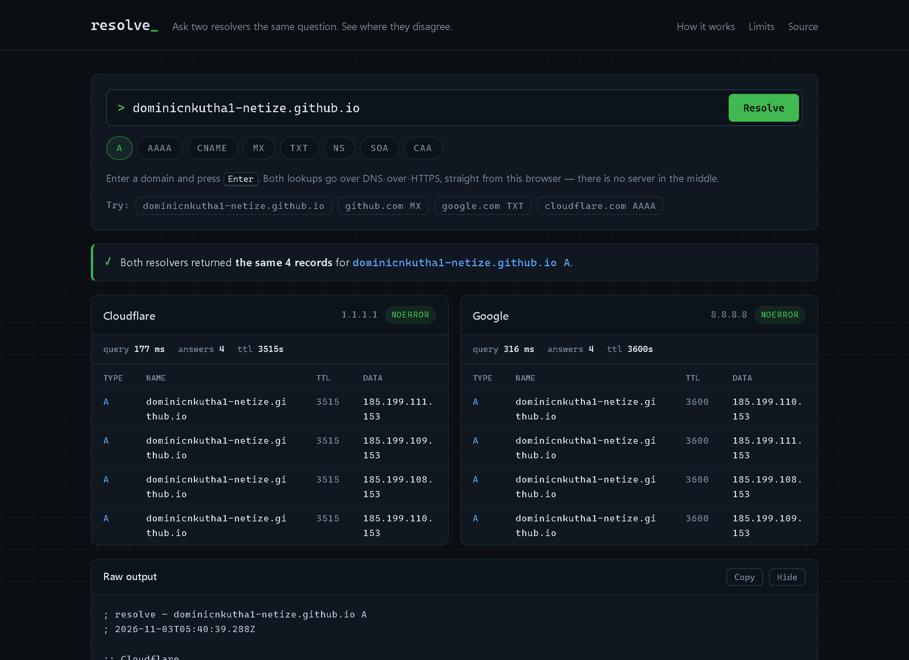
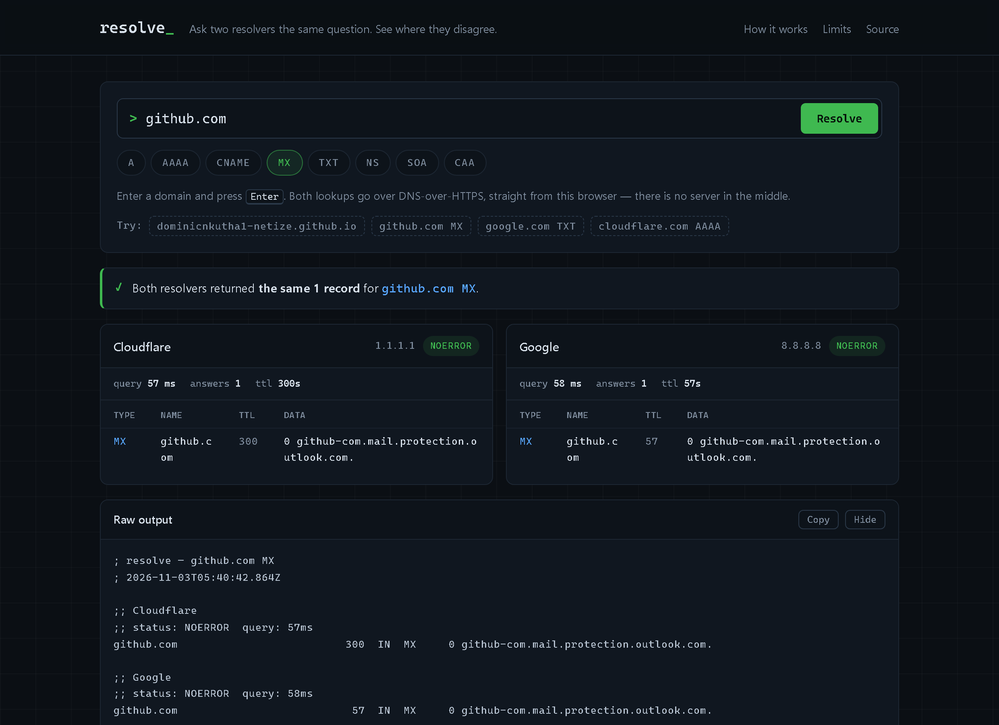
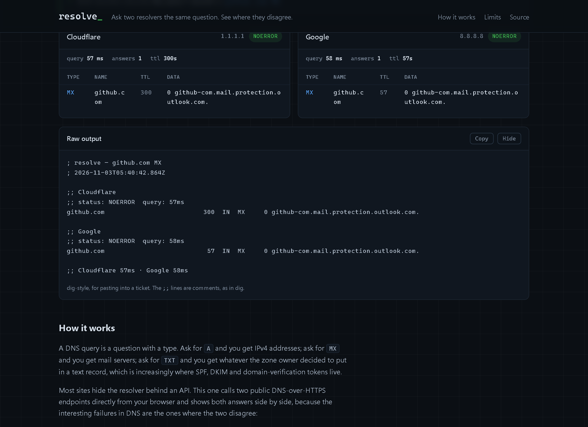
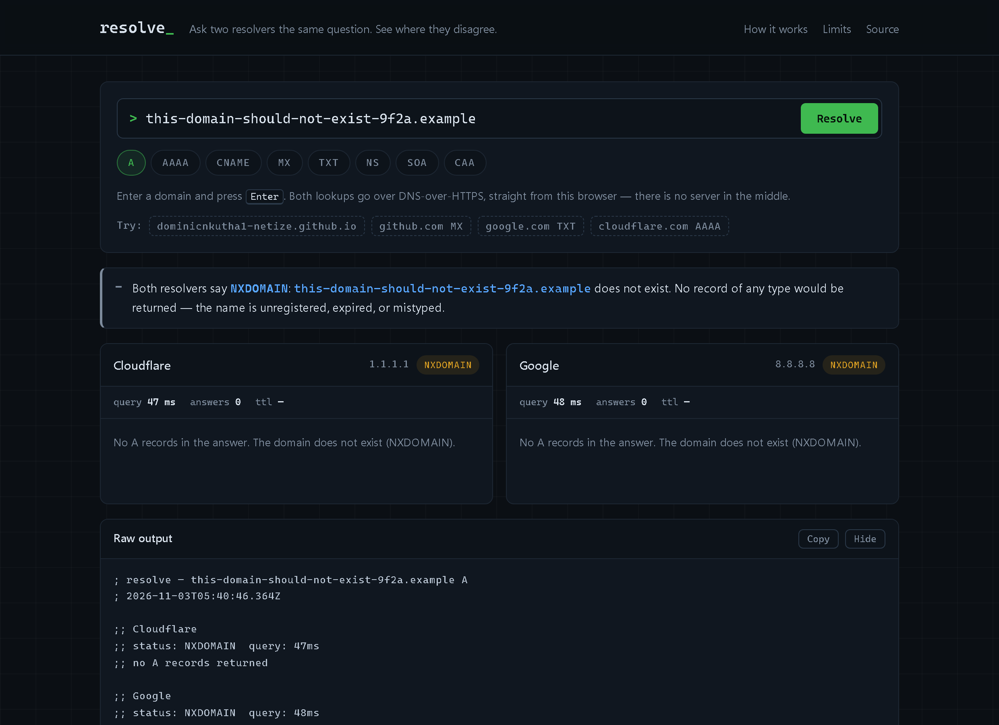
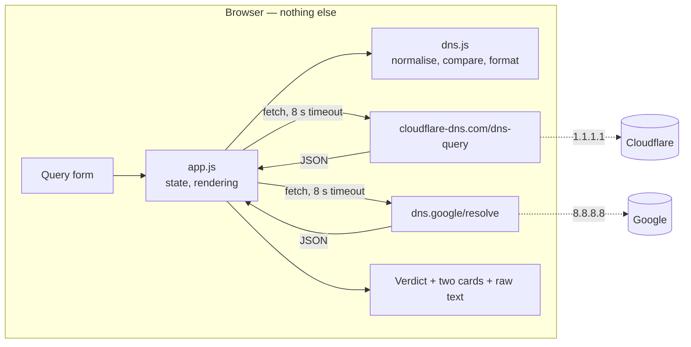

# resolve

**Ask Cloudflare and Google the same DNS question at the same time, then see exactly where their answers differ. A single page, no build step, no server, no dependencies.**

<p>
  <a href="https://github.com/dominicnkutha1-netize/resolve/actions/workflows/ci.yml"></a>
  
  
  
  
  
  
</p>

**[▶ Open resolve](https://dominicnkutha1-netize.github.io/resolve/)** — it runs a real lookup as soon as the page loads.

<p align="center">
  <a href="docs/screenshots/a-record.png"></a>
</p>

<sub><b>Two resolvers, one question.</b> The verdict bar at the top answers the only question that matters — do they agree? — before you read a single record. Captured from the live page, mid-lookup, with nothing mocked.</sub>

<table>
  <tr>
    <td width="50%" valign="top">
      <a href="docs/screenshots/mx-records.png"></a><br>
      <sub><b>Any record type</b> — A, AAAA, CNAME, MX, TXT, NS, SOA and CAA, each resolver in its own card with its query time, answer count and TTL window.</sub>
    </td>
    <td width="50%" valign="top">
      <a href="docs/screenshots/raw-output.png"></a><br>
      <sub><b>dig-style output</b> — the same answers as plain text you can paste into a ticket, because screenshots do not go into ticket comments.</sub>
    </td>
  </tr>
</table>

<p align="center">
  <a href="docs/screenshots/nxdomain.png"></a>
</p>

<sub><b>The boring case, done properly.</b> "No answers" and "no such domain" are different outcomes, so the page names which one happened instead of showing an empty table. Both resolvers agree here — that is the correct, uninteresting result.</sub>

---

## Contents

- [Why this exists](#why-this-exists)
- [Features](#features)
- [How it works](#how-it-works)
- [Tech stack](#tech-stack)
- [Quick start](#quick-start)
- [Testing](#testing)
- [Deployment](#deployment)
- [Design decisions](#design-decisions)
- [Known limitations](#known-limitations)
- [Roadmap](#roadmap)
- [License](#license)

---

## Why this exists

DNS problems are usually not "DNS is down". They are "it works on my machine",
"it worked ten minutes ago", and "it works for me but not for the client in
Cape Town". Almost every one of those is a disagreement: two resolvers holding
different answers because one has a stale cache, a change has not finished
propagating, or the zone uses split-horizon responses on purpose.

Asking one resolver tells you what one machine believes. Asking two at the same
time, and diffing them, tells you which of those it is.

The usual tools for this need a shell and a `dig` install, which is fine until
you are on a support call with a colleague's laptop, a locked-down machine, or a
phone. This is the same check in a browser tab.

It is also a deliberate exercise in doing a small thing completely: a real
comparison instead of a lookup box, a test suite for the parts that can be
tested, and an honest account of what the tool cannot see.

## Features

| Area | What it does |
|---|---|
| 🔀 **Dual lookup** | Queries Cloudflare (`1.1.1.1`) and Google (`8.8.8.8`) in parallel and renders both answers side by side |
| ⚖️ **Verdict bar** | States, in words, whether the resolvers agree, disagree, both return nothing, or the name does not exist |
| 🧾 **Record types** | `A`, `AAAA`, `CNAME`, `MX`, `TXT`, `NS`, `SOA`, `CAA` |
| ⏱️ **Per-resolver timing** | Query time, answer count and the min–max TTL window for each answer |
| 🧹 **Normalised comparison** | Ignores case, the trailing root dot and TTL differences, so cosmetic differences are not reported as a disagreement |
| 📋 **dig-style output** | Plain-text rendering of both answers, with a copy button |
| 🔗 **Deep links** | `?name=example.com&type=MX` is shareable and re-runs on load |
| ⚡ **No build, no dependencies** | Three static files. Nothing to compile, nothing to keep patched |
| 🔒 **Nothing leaves the browser** | No backend, no analytics, no cookies — queries go straight to the two resolvers |
| ♿ **Keyboard and screen readers** | Labelled input, labelled record-type controls, `aria-live` results, reduced-motion support, visible focus |

## How it works



Both providers expose a JSON API over DNS-over-HTTPS and both send
`Access-Control-Allow-Origin: *`, which is what makes a serverless browser tool
possible at all. The page calls them directly with `cache: 'no-store'`, so you
are seeing the resolver's answer right now, not something this page remembered.

The two requests are issued with `Promise.all`, so the wall-clock time is the
slower of the two, not the sum. If one resolver times out after 8 seconds, the
other answer is still displayed — a failed comparison is more useful with half
the evidence than with none.

`dns.js` holds everything worth testing and none of the DOM:

| Function | Job |
|---|---|
| `normaliseName` | Lowercase, strip the trailing root dot. Google returns `example.com.`; Cloudflare returns `example.com` — comparing raw strings would report a disagreement on every query |
| `compare` | Set difference over `(type, name, data)` keys, ignoring TTL |
| `statusLabel` | Distinguishes `NOERROR` from `NOERROR (NO ANSWERS)` from `NXDOMAIN` |
| `toDig` | Renders the dig-style text without pretending to be `dig` |
| `answerKey` | One comparable string per record |

## Tech stack

| Layer | Choice | Why |
|---|---|---|
| Markup | Hand-written HTML | One page; a framework would add a build step for nothing |
| Styling | Hand-written CSS, custom properties | No preprocessor, no utility framework |
| Logic | Native ES modules | `<script type="module">`, no bundler |
| Transport | `fetch` + `AbortController` | Timeout per resolver without a library |
| Data | DNS-over-HTTPS JSON APIs | CORS-enabled, no key, no quota to manage |
| Tests | `node:test` + `node:assert` | Zero dependencies, runs on a bare Node install |
| CI | GitHub Actions | Tests on Node 20 and 22, plus a static-site integrity check |
| Hosting | GitHub Pages | Static files, HTTPS, free |

## Quick start

There is no install step. Serve the folder over HTTP — `file://` will not load
ES modules — and open it:

```bash
git clone https://github.com/dominicnkutha1-netize/resolve.git
cd resolve

python -m http.server 8080
# or: npx serve . -l 8080
```

Open <http://localhost:8080>. The first lookup runs automatically.

Editing is the same loop: change a file, reload. There is no watch process
because there is nothing to rebuild.

## Testing

```bash
node --test
```

26 tests, two files, no dependencies.

`tests/dns.test.mjs` (16) covers the logic that is easy to get subtly wrong:
name normalisation and the trailing-dot trap, validation of the things people
actually paste (`http://`, wildcards, double dots, 253+ character names),
`NXDOMAIN` versus an empty answer, agreement when only TTL and case differ,
disagreement when records differ, a failed resolver not being treated as "no
records", and the dig-style formatter.

`tests/site.test.mjs` (10) covers the failure modes of a static site: every
`src`/`href` in `index.html` resolving to a real file, every import resolving,
**every screenshot the README links actually being committed**, required
metadata for shared links, alt text on images, no third-party scripts or fonts
(the page claims to load nothing external, so CI enforces it), no leftover
`console.log`/`debugger`, and the documented run/test commands still existing.

That screenshot test exists because its absence is a real bug I shipped once:
a README that renders a broken image on the repository page. It is a cheap
check that catches an embarrassing class of mistake.

CI runs the same suite on Node 20 and 22, then checks that `README.md`,
`LICENSE` and the Pages entry point are all present.

## Deployment

The repository is the deployment. GitHub Pages serves `main` from the root:

1. **Settings → Pages → Source: Deploy from a branch → `main` / `/ (root)`**
2. Push to `main`; Pages rebuilds in about a minute.
3. `https://dominicnkutha1-netize.github.io/resolve/`

There is no environment variable, no secret and no server to keep alive, which
is also why the demo cannot break in the way a free-tier backend does. The only
runtime dependency is that the two DNS providers keep serving CORS-enabled DoH —
if either changes that policy, the tool fails loudly rather than silently.

The same three files work on any static host.

## Design decisions

**Comparing answers, not just returning them.** A lookup box is a solved,
uninteresting problem. The comparison is the product: it turns "here are some
records" into "these two caches disagree, and here is the record that only one
of them has".

**TTL ignored in the comparison, shown in the UI.** A one-second TTL difference
is not a disagreement; it is two caches at different points in the same countdown.
Reporting it as one would make the tool cry wolf on nearly every query, so TTL is
displayed but excluded from the diff.

**No server.** A backend would let me cache, log and normalise — and would also
mean the tool breaks when the free tier sleeps, and that a stranger's DNS queries
land in my logs. Calling the resolvers directly keeps the promise on the page
honest: no server, nothing stored.

**Failures are rendered, not thrown.** Each request returns a result object with
`ok: false` and a reason. A timeout on one side leaves the other side's answer on
screen, because half an answer plus a clear "Google timed out" is more useful
than an empty page.

**`dns.js` is DOM-free on purpose.** The comparison logic is the part with edge
cases, so it is the part that has to be testable in Node without a browser, a
network call or a mocking library.

## Known limitations

Honest list, because a tool that claims to see everything has not been thought
about hard enough.

- **It is not your resolver.** The page shows what Cloudflare and Google see. Your
  laptop may use an ISP resolver, a corporate DNS server, or a `hosts` file — none
  of which this tool can see. That difference is exactly why "it works on my
  machine" happens, but it does mean this is not a substitute for checking the
  machine itself.
- **Not a DNSSEC validator.** The `AD` flag is displayed as returned; the page does
  not validate signatures and must not be used to sign off a DNSSEC rollout.
- **Transport is invisible.** DNS-over-HTTPS hides UDP, TCP fallback, truncation
  and EDNS behaviour, so none of that can be diagnosed here.
- **Private zones will fail.** Internal names do not resolve publicly. That is
  expected, not a fault in the tool.
- **Two providers, not the world.** Agreement between Cloudflare and Google is
  strong evidence, not proof that every resolver has the same answer.
- **CORS is a dependency.** If either provider stops sending
  `Access-Control-Allow-Origin: *`, that resolver's card will show a network
  error. There is no server-side fallback by design.
- **No history.** Each lookup is a fresh query; the page does not plot how an
  answer changed over time.

## Roadmap

1. ✅ **Compare, do not just look up** — dual resolvers, normalised diff, verdict.
2. ✅ **Tests** — 26 tests with `node:test`, run in CI on Node 20 and 22.
3. ✅ **Screenshots in the README** — real captures, with a test that stops a
   broken image from ever reaching the repository page.
4. **A third resolver** — Quad9 (`9.9.9.9`) via DoH, to separate "one resolver is
   stale" from "the zone is inconsistent".
5. **Propagation timeline** — re-query on an interval and chart the TTL countdown
   so a propagation window can be estimated rather than guessed.
6. **DNSSEC detail** — surface the `AD` flag per record and link to a real
   validator instead of implying this is one.
7. **Response-time comparison** — a small distribution per resolver, because
   "which resolver is faster from here" is a question support desks actually ask.

## License

MIT — see [LICENSE](LICENSE). © 2026 Dominic Nkutha
